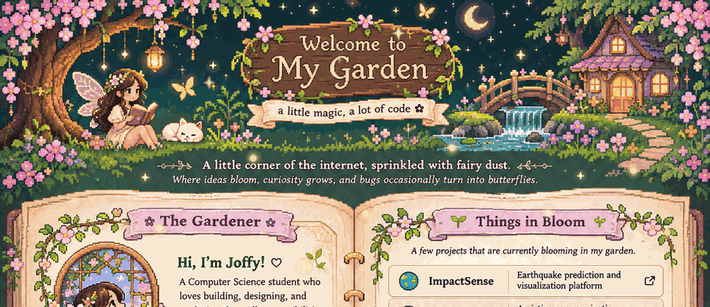
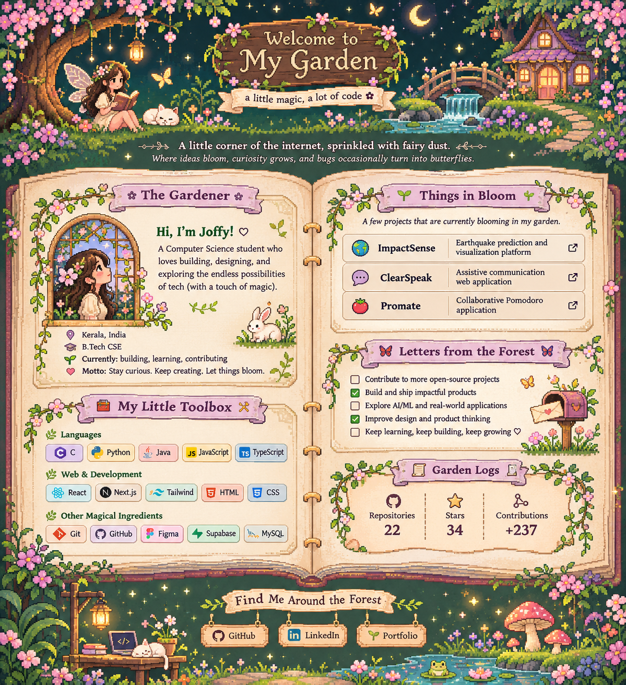

# ✿ Welcome to my garden ✿

### a little magic, a lot of code

*A little corner of the internet, sprinkled with fairy dust.*  
*Where ideas bloom, curiosity grows, and bugs occasionally turn into butterflies.*

---

**✧ ────────────────  a little map of the garden  ──────────────── ✧**

[🌿 The Gardener](#-the-gardener) ·
[🪄 My Little Toolbox](#-my-little-toolbox) ·
[🌷 Things in Bloom](#-things-in-bloom) ·
[💌 Letters from the Forest](#-letters-from-the-forest)

## 🌿 The Gardener

Hi, I'm **Joffy** — a Computer Science student who loves building things, designing experiences, and turning curious ideas into working projects.

I'm happiest somewhere between logic and imagination: exploring how things work, experimenting with new technologies, and making the web a little more delightful.

- 🌱 **Currently growing:** web applications, AI/ML experiments, and open-source contributions
- 🎨 **I enjoy:** software development, UI/UX, visual design, and creative problem-solving
- 🧚 **Always learning:** new tools, better engineering practices, and how to build things with people
- 💚 **Garden motto:** Stay curious. Keep creating. Let things bloom.

 

## 🪄 My Little Toolbox

*Every fairy has a wand. Mine just happens to be a keyboard.*

**Languages**

**Web & development**

**Other magical ingredients**

## 🌷 Things in Bloom

*A few little creations growing in my garden.*

| Project | What it does |
|---|---|
| 🌍 **ImpactSense** | An earthquake prediction and visualization platform with interactive data views. |
| 🗣️ **ClearSpeak** | An assistive communication web application. |
| 🍅 **Promate** | A real-time collaborative Pomodoro application. |

More experiments, ideas, and little creations are growing behind the scenes.

[🌱 Explore my repositories →](https://github.com/Joffy-Maria?tab=repositories)

## 🦋 Growing in the open

I believe beautiful things happen when people build together. I'm exploring the world of **FOSS**, learning from established codebases, fixing bugs, building features, and collaborating with developer communities.

My open-source journey is just beginning — one issue, one review, and one pull request at a time.

> Every pull request is another flower in the garden. 🌷

## 🍄 A little GitHub magic

*These cards are provided by a third-party service; if they ever take a nap, the rest of the garden will still be here.*

## 💌 Letters from the Forest

Want to say hello, explore something I've built, or collaborate on an idea?

 

*Thanks for wandering through my little corner of the internet.*

**May your bugs be few and your ideas bloom endlessly.** 🧚‍♀️

