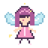
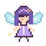

 &nbsp;
 &nbsp;
 &nbsp;
 &nbsp;

# ✧ Joffy Maria Pius ✧

*｡･ﾟﾟ･ a little code, a little creativity, and a little fairy dust ･ﾟﾟ･｡*

**B.Tech Computer Science student · Developer · UI/UX enthusiast**

## 🧚 a little about me

Hello! I'm a computer science student who loves bringing ideas to life through code and design.

- 🌷 I enjoy building websites and experimenting with creative ideas.
- 🎨 Interested in **UI/UX, frontend development, AI/ML, and open source**.
- 🌱 Currently learning, building, and finding new things to get curious about.
- ✨ I like projects that are useful, thoughtful, and a little different.

## ✿ my little toolbox

**Languages**

**Frameworks, tools & design**

## 🌸 things growing in my garden

| Project | What it is |
|:--|:--|
| [**ImpactSense**](https://github.com/Joffy-Maria/ImpactSense) | Earthquake prediction and visualization platform using machine learning and interactive visualizations. |
| **ClearSpeak** | Assistive communication web app exploring accessible interaction and speech tools. |
| **Promate** | Real-time collaborative Pomodoro app. |
| **SkillDev** | Skill-development platform built with Supabase. |
| **PazhamVision** | Playful banana-themed project with interactive game elements. |

&nbsp;  &nbsp;

## ✨ currently in my spellbook

- 🌱 Exploring open-source contributions.
- 💻 Practising problem-solving and building projects.
- 🎀 Improving my UI/UX and product design skills.

**♡ thanks for visiting my little corner of GitHub ♡**

